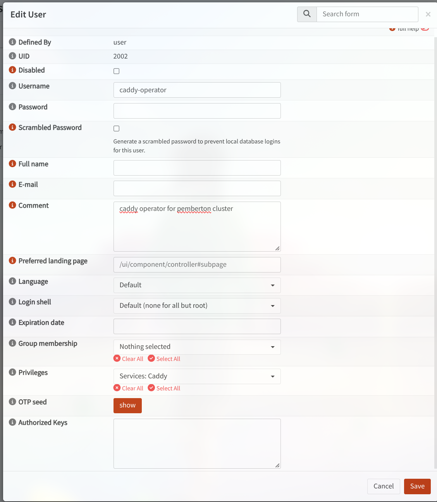

# caddy-gateway-sync

Kubernetes operator that reconciles public Gateway API HTTPRoutes with the
**Caddy reverse proxy of an OPNsense firewall** (plugin **os-caddy**).

One HTTPRoute hostname attached to the HTTP listener of a public Gateway →
one Caddy reverse proxy (TLS via Let's Encrypt DNS-01) that proxies to the
Gateway VIP. Deleting the route removes the Caddy routing on the next
reconcile (no finalizer: cleanup is done by the desired-state diff, so a
deleted route never blocks in Terminating). DNS (CNAME to the edge) is
handled separately by external-dns.

```
HTTPRoute (parentRef public/http + hostname)
  ├─ external-dns ────────► CNAME <hostname> -> <edge-host> (Cloudflare)
  └─ caddy-gateway-sync ──► OPNsense API ──► Caddy:
        reverse proxy  : <hostname>, TLS Let's Encrypt (DNS-01)
        handle         : reverse_proxy -> <gateway VIP>:80 (Host preserved)
```

## Sync model

Mirrors ArgoCD: the cluster side is pure **push** (watches the API server, no
polling), while the OPNsense side is a **refresh interval**
(`reconcileInterval`, 900 s by default) because os-caddy cannot emit webhooks —
that is the only way to catch drift made by hand in the Caddy GUI.

## Safety rails

- **Ownership marker** in the Caddy entry `description`:
  `[gitops] httproute:<ns>/<name>` (configurable). Only marked entries are
  modified or deleted; manual entries are never touched.
- **Adoption**: an existing manual entry for the same hostname is marked, not
  duplicated (Caddy refuses a Caddyfile with two sites at the same address).
  Adoption rewrites the entry and deletes it when the route goes away, so it
  requires explicit intent: annotation `caddy-gateway-sync/adopt: "true"` on
  the HTTPRoute. Entries already owned by the operator are re-marked without it.
- **Deletion**: `delHandle` then `delReverseProxy` (plugin safeDelete order).
- **A single reload** (`/api/caddy/service/reconfigure`) per pass, whatever the
  number of changes. A failed reload leaves Caddy on the previous config.
- **Adoption requires intent**: claiming an unmarked manual Caddy entry needs
  the annotation `caddy-gateway-sync/adopt: "true"` on the HTTPRoute —
  adoption rewrites the entry (DNS-01, no access log) and deletes it when the
  route goes away.
- Hostnames are validated locally before reaching OPNsense.
- Without credentials the pod stands by (`sleep infinity`) and touches nothing.
  Env from Secrets is fixed at container start: restart the Deployment after
  creating the Secret, or rely on a Reloader installation.

## Installing

1. On OPNsense, create a dedicated user with minimal privileges —
   **Services: Caddy** is enough (screenshot below) — then generate an API key
   (System > Access > Users > API key `+`).

   

2. Allow the API port from the cluster on the firewall
   (`pass in` from LAN/cluster subnet → This Firewall, port 8443).

3. Provide credentials either through your own Secret:

   ```yaml
   apiVersion: v1
   kind: Secret
   metadata:
     name: caddy-gateway-sync
     namespace: gateway-system
   stringData:
     OPNSENSE_URL: https://opnsense.example.lan:8443
     OPNSENSE_API_KEY: <key>
     OPNSENSE_API_SECRET: <secret>
   ```

   ... and set `opnsense.existingSecret=caddy-gateway-sync`. The chart never
   takes credentials from values (no `apiKey`/`apiSecret` keys): create the
   Secret yourself — SealedSecrets / ExternalSecrets keep them out of git.

   TLS verification of the API is on by default (the key/secret travel as Basic
   auth on that connection). If the firewall certificate is issued by a private
   CA, put the CA in a Secret under the key `ca.crt` and set
   `opnsense.caSecret=<secret>`; `opnsense.tlsInsecure="1"` is an explicit
   opt-out.

4. Install the chart:

   ```bash
   # From the OCI registry
   helm install caddy-gateway-sync \
     oci://ghcr.io/pemberton-cluster/charts/caddy-gateway-sync --version 0.2.0 \
     --namespace gateway-system \
     --set opnsense.existingSecret=caddy-gateway-sync

   # Or from the HTTP chart repository
   helm repo add caddy-gateway-sync https://pemberton-cluster.github.io/caddy-gateway-sync
   helm repo update
   helm install caddy-gateway-sync caddy-gateway-sync/caddy-gateway-sync \
     --namespace gateway-system \
     --set opnsense.existingSecret=caddy-gateway-sync
   ```

ArgoCD users: multi-source Application with `oci://` (native OCI mode) or a
`helm` source pointing at the HTTP repo, `$values` ref for the values file.

## Configuration

| Key | Default | Description |
|---|---|---|
| `opnsense.url` | `""` | Base URL of the OPNsense API |
| `opnsense.existingSecret` | `""` | Secret with `OPNSENSE_URL`, `OPNSENSE_API_KEY`, `OPNSENSE_API_SECRET` |
| `opnsense.caSecret` | `""` | Secret with the firewall CA (`ca.crt` key), trusted for the API connection |
| `opnsense.tlsInsecure` | `"0"` | `"1"` = disable API TLS verification (explicit opt-out; prefer `opnsense.caSecret`) |
| `gateway.namespace` / `gateway.name` | `gateway-system` / `public` | Gateway to observe |
| `gateway.listener` | `http` | HTTP listener name on that Gateway |
| `upstream.host` / `upstream.port` | `10.10.16.38` / `"80"` | Gateway VIP Caddy proxies to |
| `reconcileInterval` | `900` | Drift refresh interval (seconds) |
| `markerPrefix` | `[gitops] httproute:` | Ownership marker in `description` |
| `planOnly` | `"0"` | `"1"` = log the diff, write nothing |
| `image.repository` | `ghcr.io/pemberton-cluster/caddy-gateway-sync/operator` | Dedicated operator image (built by CI) |
| `image.tag` | `""` (chart appVersion) | Image tag |
| `networkPolicy.enabled` / `opnsenseCidr` | `true` / `""` | Default-deny netpol; set the firewall IP/subnet |
| `resources`, `securityContext`, `podAnnotations`, `nodeSelector`, `tolerations`, `affinity` | see `values.yaml` | Workload tuning |

## Dependencies

Runtime: [kopf](https://kopf.readthedocs.io/) (event/timer framework) and the
[kubernetes](https://github.com/kubernetes-client/python) Python client,
baked into a dedicated image built by CI (base image digest-pinned, full
transitive closure frozen in `operator/constraints.txt`) — the pod never talks
to PyPI at runtime. Server side: an OPNsense firewall with the **os-caddy**
plugin, and a Kubernetes cluster with Gateway API CRDs installed.

## OPNsense API gotchas

- **A GET carrying `Content-Type: application/json` with no body returns 400
  "Invalid JSON syntax"** → only set the header when a body is present.
- **A POST without a body returns 400** → send `{}`.
- Endpoints live under `/api/caddy/*` (handled by the plugin, not core FRR).

## Network policy

The chart ships a default-deny NetworkPolicy (no ingress; egress limited to
DNS, the Kubernetes API server and the OPNsense API). Set
`networkPolicy.opnsenseCidr` to the firewall IP/subnet — until you do, the
operator cannot reach OPNsense:
`--set networkPolicy.opnsenseCidr=192.168.1.1/32`.

## Publishing the chart (maintainers)

Pushing to `main` triggers the release workflow: `helm lint` + template check,
then the chart is published to **both** `oci://ghcr.io/pemberton-cluster/charts/caddy-gateway-sync`
and the GitHub Pages HTTP repository (`index.yaml` on `gh-pages`).
